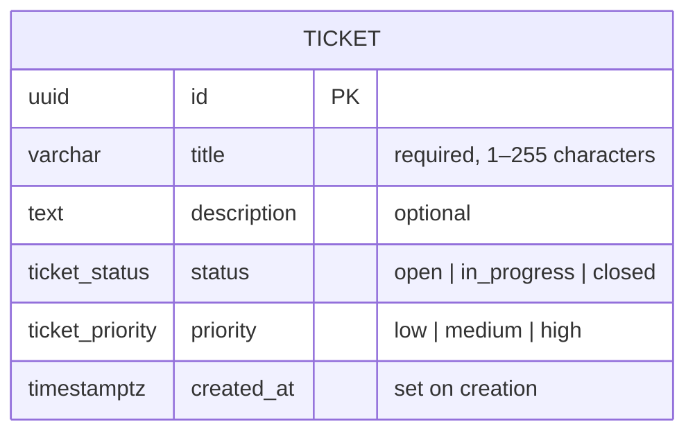

# Mini Ticket Tracker architecture

## System overview

```text
Angular frontend
        |
        | HTTP (JSON)
        v
Node.js / Express API
        |
        | pg, parameterized SQL
        v
Local PostgreSQL
```

One main Angular page contains the ticket table, creation form, and a details panel. A status filter and server-side pagination keep the list small. The UI refreshes the list and counts after each successful mutation. It does not invent users, comments, authentication, or extra ticket fields.

## Entity relationship diagram



There is one entity and no relationships. Node generates UUIDs with `crypto.randomUUID()`. PostgreSQL enforces enum values and a nonblank title; `created_at` records an absolute instant. Listing orders by `created_at DESC, id DESC` for deterministic pagination.

## Request flow

```text
Angular UI → TicketService → HTTP → Express routes
                                      ↓
                                  Controller
                                      ↓
                                   Service
                                      ↓
                                  Repository
                                      ↓
                                  PostgreSQL
```

Routes map URLs to controllers. Controllers validate HTTP inputs and choose response codes. The service provides defaults and the not-found behavior. The repository owns SQL; the database module owns the connection pool. Errors reach one middleware with safe JSON responses.

## API contract

| Method | Path | Behavior |
| --- | --- | --- |
| POST | /tickets | Required title and priority; optional description and status (defaults to open); 201 with ticket |
| GET | /tickets | Optional status; page defaults to 1, limit to 10 (maximum 100); returns items, total, page, limit |
| PATCH | /tickets/:id | Update only status and/or priority; 200 with ticket or 404 |
| GET | /tickets/stats | Counts for open, in_progress, closed, including zeroes |

Invalid input returns 400. Unknown routes return 404. Unexpected failures return 500 without database details. All SQL values are parameterized. A count and page are fetched in one SQL statement so their snapshot is consistent. The Angular development proxy forwards these same paths to the API; no CORS dependency is needed.

## Verification

Three API integration tests use Express, Supertest, and a real, isolated PostgreSQL test database. They cover creation/validation/update behavior, status filtering with actual SQL pagination, and grouped statistics. Tests require a database name ending in `_test` and never truncate the development database. Manual browser verification covers the form, filter, pagination, inline status changes, details updates, and responsive layout.

## Public deployment

The frontend Vercel project serves the same Angular page. Its `/tickets` rewrite forwards requests to the separate native Express Vercel project, which connects through `pg` to a new isolated Neon Free PostgreSQL database. The production-only API Secret uses TLS with certificate verification. The entity, migration, four endpoints, and application layers are unchanged. Local development uses the Angular proxy and local PostgreSQL; previews have no production database credential.
